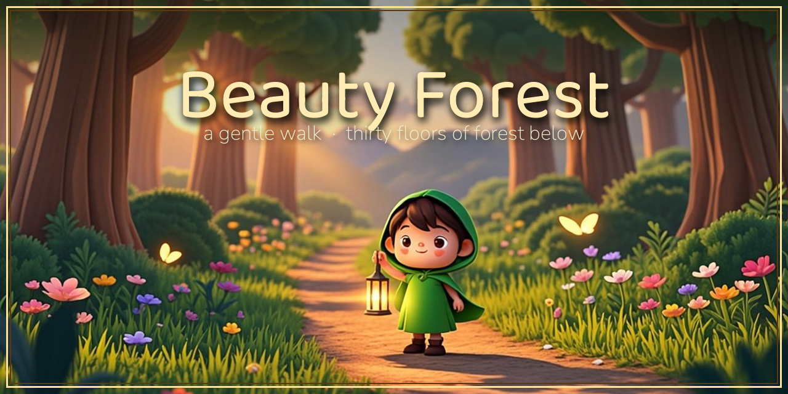
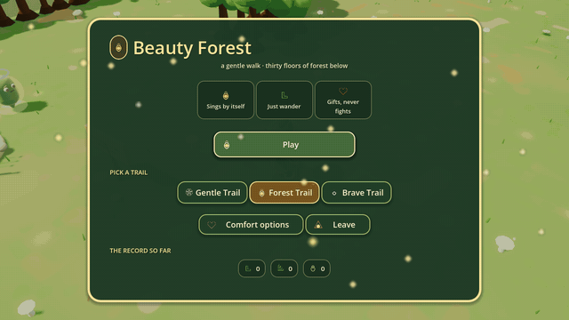

# Beauty Forest

<div align="center">



[](https://mlibre.github.io/beauty-forest/)
[](https://github.com/mlibre/beauty-forest/releases)
[](https://github.com/mlibre/beauty-forest/actions/workflows/pages.yml)




*a few moments from a walk — the title, the story, the forest floor, and a level-up gift*

</div>

A cozy walk through an enchanted forest at golden dusk. Your lantern does the
singing — you do the wandering. Lost wisps drift through the roots, dim and
lonely, waiting for someone kind to wander by; hum until they glow, follow the
light to the stairwell, and see how deep the forest goes.

**Everything you see and hear is grown by the game itself** — the forest, the
wisps, the music, the hero, the dragon at the bottom. The only files it ships
are two open-licensed typefaces (`assets/fonts/`); no asset packs, no
downloads, no account. Just the game, grown fresh on every machine that runs
it.

## About the game

- **A survivor walk with no attack button.** Your lantern sings by itself —
  close wisps get a soothing pulse, distant ones get homing song-notes. Your
  job is to wander, dodge, and choose a path. Nothing here can truly hurt you,
  and nobody is ever cross.
- **Warmth is your lantern's light.** Bumps dim it, thank-you hearts and
  stairwells refill it, and the lantern in the world dims right along with it
  — the readout and the world can never disagree.
- **Follow the glow.** A glowing marker shows the way to the stairwell. Every
  floor below is a little stranger and a little more generous than the last,
  and every tenth floor the forest throws petals.
- **Peddle's cart.** A shelf of pictures: warm tea, charms for your belt,
  songs for your lantern. Every card says exactly what it does, and a charm
  you love can be loved again — buy it deeper and it comes back stronger.
- **The wishing pool.** One small wish a floor: toss a sparkle in, catch the
  warmth that comes back up.
- **Mote walks beside you.** Her lines arrive as little story cards during the
  walk, and every level-up card carries a fresh real-world fact she just
  learned ("Octopuses have three hearts — two just for the gills").
- **A lullaby grown note by note.** Every region of the forest hums its own
  music-box melody, composed when you arrive, and it bows out politely for the
  quiet moments.
- **Thirty floors — and then the forest keeps growing.** New regions, new
  stories, and one enormous cousin yawning for more lullabies.

## Play it in your browser

Nothing to install — the main branch is built and published to GitHub Pages
automatically:

### **[▶️ Open Beauty Forest](https://mlibre.github.io/beauty-forest/)**

Click **Play**, pick a trail (Gentle, Forest, or Brave), and walk. The web
build is single-threaded on purpose, so it runs on any static host —
desktop, laptop, tablet, or phone (on a touch screen an on-screen joystick
appears instead of WASD).

## Install it

Grab a build from the
[**Releases**](https://github.com/mlibre/beauty-forest/releases) page — every
push to `master` re-points the rolling **`latest`** release at a fresh build,
and every `v*` tag gets its own:

| Platform | File | Notes |
| --- | --- | --- |
| **Windows** | `BeautyForest-Windows.zip` → `BeautyForest.exe` | unzip anywhere and run |
| **Linux** | `BeautyForest-Linux.zip` → `BeautyForest.x86_64` | `chmod +x`, then run |
| **Android** | `BeautyForest-Android.apk` | sideload; self-signed keystore |
| **Web (offline)** | `BeautyForest-Web.zip` | the same build Pages serves, zipped |
| **macOS** | run from source below | no signed build yet |

No installer, no dependencies, no account: the download *is* the game.

### Run from source

Any machine with [Godot 4](https://godotengine.org/download) can grow the
forest from this repository:

```bash
godot --path .
```

or open `project.godot` in the Godot editor and press **F5**.

## Controls

| Key                            | What it does                                                         |
| ------------------------------ | -------------------------------------------------------------------- |
| **WASD / arrows / left stick** | wander                                                               |
| **Shift / shoulder button**    | a quick dash that nothing can touch                                  |
| **E / gamepad A**              | take the stairwell, start a Big Feeling's song, catch a GOLD beat, or make a wish |
| **F**                          | browse Peddle's cart when the cart is near                           |
| **J**                          | Mote's memory book — fun facts and stickers                          |
| **C**                          | comfort options                                                      |
| **Esc**                        | pause (and the one place with numbers in it)                         |
| **F11**                        | fullscreen                                                           |

On a touch screen, an on-screen joystick and big corner buttons appear
instead.

## Comfort options

Press **C** anywhere: high contrast, gentler wisp speeds, a wider rhythm
window, a quieter forest. Change anything, any time — nothing is a test,
nothing is graded. A run ends with a nap card or a dragon tucked in; leaving
is always okay.

## Building and shipping

The game exports with the presets in `export_presets.cfg`:

```bash
godot --headless --path . --import
godot --headless --path . --export-release "Web" builds/web/index.html
godot --headless --path . --export-release "Windows" builds/windows/BeautyForest.exe
godot --headless --path . --export-release "Linux" builds/linux/BeautyForest.x86_64
godot --headless --path . --export-release "Android" builds/android/BeautyForest.apk
```

CI (`.github/workflows/`) does all of this on GitHub's machines:

- **pages.yml** — every push to `master` rebuilds the web export and deploys
  it to GitHub Pages.
- **release.yml** — every push to `master` re-points the rolling `latest`
  release at a fresh set of Windows, Linux and Android builds, and every
  `v*` tag gets its own release. The Android APK is self-signed by a
  keystore generated inside the runner; replace it with your own store
  keystore before publishing to Google Play.

`docs/TESTING.md` is the development run-book: 24 headless regression suites,
art gates for the procedural glyphs, and measurement probes under `_audit/`.
`AGENTS.md` holds the design rules every change is held to.

## 🇵🇸 In Support of Palestine

This project supports Palestine. If you can, donate to [UNRWA](https://www.unrwa.org).

The people of Palestine endure daily suffering and loss, too often unseen and
unhelped. They are asking for support — and we can give our voice, our care,
and our help. Even a small act can matter. Please do what you can. 🤲

And if you ever doubt what is right and what is wrong, remember: when someone
kills a baby to loot baby’s belongings, he is the devil — and he stands on the
wrong side. ✊
